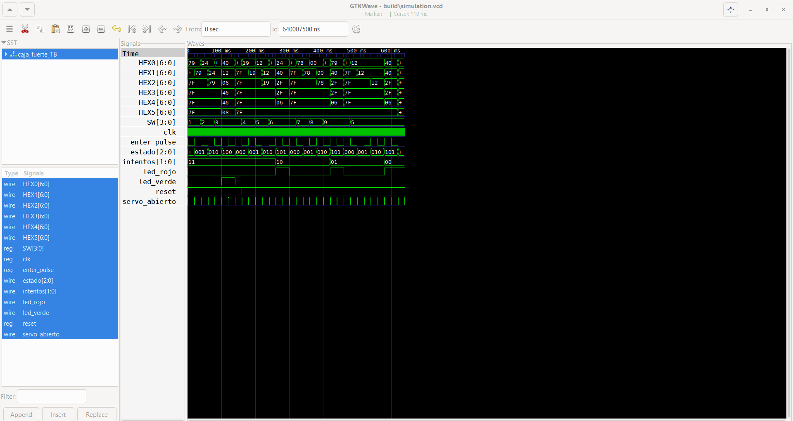

# Lab 06 - Caja fuerte

## Integrantes

- [Daniel Alejandro Arevalo Castiblanco](https://github.com/danielarev10)
- [Andres Bustos](https://github.com/andresfebustosva-coder)
- [Nicolas Santiago Ayala Rivera](https://github.com/nicolassaayalari-web)

---

## 1. Video de funcionamiento

En el siguiente enlace se encuentra el video de funcionamiento de la caja fuerte.

**Enlace del video:** https://youtube.com/shorts/qHPRgyZV3mg?si=5GgSkjDo6HjhnCtu

---

## 2. Simulación en GTKWave

A continuación se presenta la captura de pantalla de la simulación realizada en GTKWave, donde se observa el comportamiento del codigo.

---
